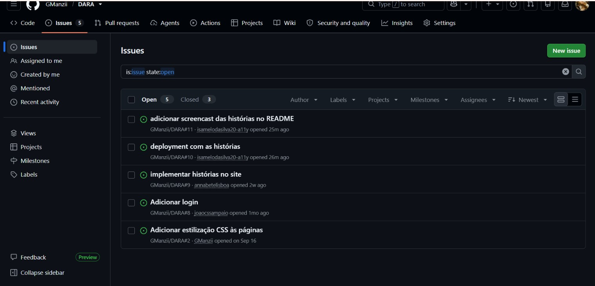
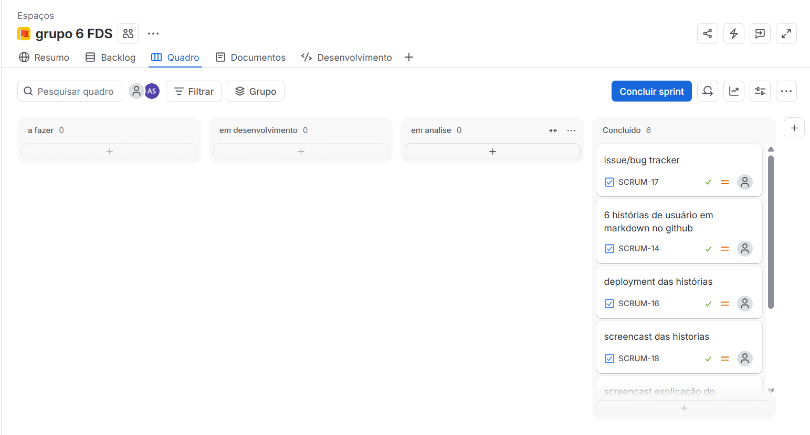
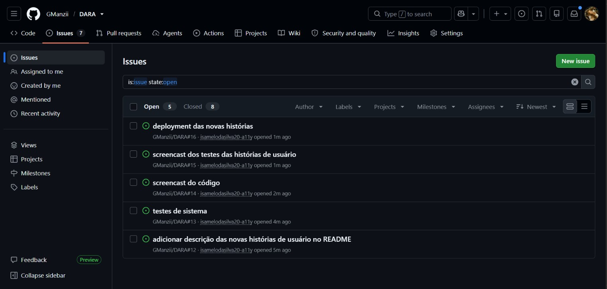
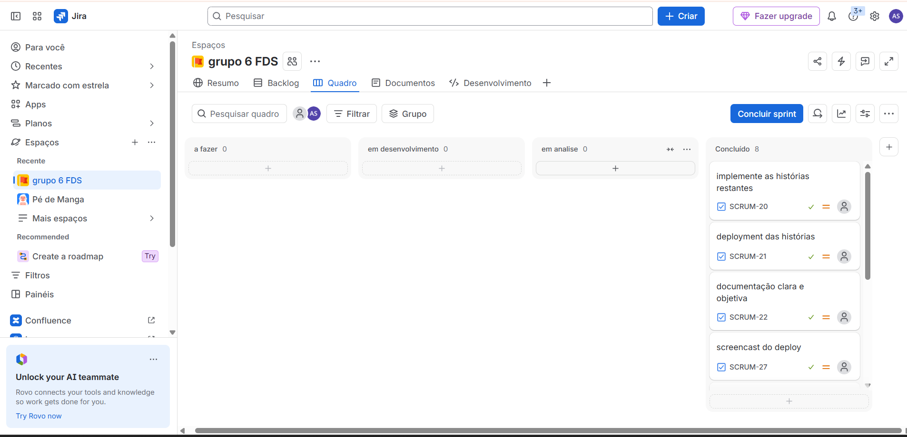

**Disciplina de Projeto 2 · Grupo 6**
# Nome do projeto: DARA

## Sobre o projeto
 
O DARA é um site e aplicativo que facilita a implementação de práticas ESG (ambiental, social e de governança) em pequenas e médias empresas.

## Tecnologias utilizadas
 
| Ferramenta | Uso |
| --- | --- |
| Python + Django | Desenvolvimento da aplicação web |
| Git + GitHub | Controle de versão e bug tracker (Issues) |
| Jira | Gestão do projeto e das sprints |
| PythonAnywhere | Deploy da aplicação |
 
---
## Como rodar o projeto localmente
 
**Pré-requisitos:** Python 3.12 ou superior e Git.
 
1. Clone o repositório e entre na pasta do projeto:
```bash
   git clone https://github.com/GManzii/Projeto-2--grupo-6.git
   cd Projeto-2--grupo-6
```
 
2. Crie e ative um ambiente virtual:
```bash
   py -m venv venv
 
   # Linux / macOS
   source venv/bin/activate
 
   # Windows
   venv\Scripts\activate
```
 
3. Instale as dependências:
```bash
   pip install -r requirements.txt
```
 
4. Crie o banco de dados:
```bash
   py manage.py migrate
```
 
5. Crie um usuário administrador (necessário para ver as mensagens enviadas pelo "Fale conosco"):
```bash
   py manage.py createsuperuser
```
 
6. Inicie o servidor:
```bash
   py manage.py runserver
```
 
O site ficará disponível em <http://127.0.0.1:8000/>.
 
---
## Entregas
<details>
<summary> Entrega 1 </summary>

[Analise_competidores](https://github.com/GManzii/Projeto-2--grupo-6/blob/main/Analise_Competidores.md)


---
</details>
<details>
<summary> Entrega 2 </summary>

#### Deployment
- Aplicação publicada: [https://daraesg.pythonanywhere.com](https://daraesg.pythonanywhere.com)
  
#### Screencasts

- Explicação do código: [Assista no YouTube](https://youtu.be/nAHVaIYzRGQ)
- Demonstração do deploy: [Assista no YouTube](https://youtu.be/BANJWZl820A)

**Bug tracker (Issues)**
 
As issues do projeto estão registradas na aba [Issues](https://github.com/GManzii/Projeto-2--grupo-6/issues) do repositório.

#### Print bug tracker


#### Print da sprint

</details>
<details>
<summary> Entrega 3 </summary>

### Histórias implementadas

<table>
<tr>
<td>

**POST-IT 01 — Escolher perfil**

**História de usuário**

Como usuário do sistema, quero escolher entre o perfil de dono e o de funcionário, para acessar a área correspondente às minhas necessidades.

**Critérios de aceitação**
- O sistema apresenta as opções de dono e funcionário.
- Ao selecionar uma opção, o usuário é direcionado à área correspondente.
- O sistema guarda a escolha na sessão.

</td>
</tr>
<tr>
<td>

 **POST-IT 02 — Acessar cadastro**

**História de usuário**

Como usuário de uma empresa, quero acessar uma área específica do sistema através de um login, para visualizar as funcionalidades do aplicativo.

**Critérios de aceitação**
- O sistema disponibiliza uma página para o usuário.
- A página apresenta a área destinada às funcionalidades administrativas.

</td>
</tr>
<tr>
<td>

**POST-IT 03 — Questionário**

**História de usuário**

Como dono, quero personalizar o sistema para as necessidades da minha empresa, para acompanhar a evolução da minha empresa na aplicação de práticas ESG.

**Critérios de aceitação**
- O sistema disponibiliza um questionário.
- A página é acessível pela opção correspondente a tela do dono.

</td>
</tr>
</table>

#### Print bug tracker


#### Print da sprint


#### Screencasts

- Explicação do código: [Assista no YouTube](https://youtu.be/U0j3na3Lk6c)
- Demonstração do deploy: [Assista no YouTube](https://youtu.be/12KqWi0HDcU?si=H74k8cRTDtOK-J46)

</details>
 <details>
<summary> Entrega 4 </summary>


[CONTRIBUTING](https://github.com/GManzii/Projeto-2--grupo-6/blob/main/CONTRIBUTING.md)

### Histórias implementadas

<table>
<tr>
<td>
 
**POST-IT 01 — Perfil (bela)**

**História de usuário**

Como gestor do sistema, quero visualizar o perfil da empresa com as informações consolidadas e métricas gerais, para acompanhar o progresso e o status da organização.

**Critérios de aceitação**

* O sistema exibe os dados do usuário e da empresa cadastrada.
* O sistema apresenta os cartões de visão geral (número de funcionários, documentos, metas e comunidades).
* Apenas usuários autenticados conseguem acessar a página de perfil.

</td>
</tr>
<tr>
<td>

**POST-IT 02 — Ajustar checklist das metas (Laís)**

**História de usuário**

Como usuário do sistema, quero visualizar e gerenciar o checklist de metas ESG da empresa, para acompanhar a evolução das tarefas concluídas e pendentes.

**Critérios de aceitação**

* O sistema exibe a lista de metas organizadas com caixas de seleção (checklists).
* O status de cada meta pode ser atualizado pelo usuário.
* O progresso é refletido dinamicamente no painel de acompanhamento.

</td>
</tr>
<tr>
<td>

**POST-IT 03 — Login/cadastre-se duplo/landing page (Bete)**

**História de usuário**

Como visitante do sistema, quero ter um fluxo intuitivo de entrada na landing page com caminhos claros para login e cadastro, para acessar o ambiente correto (dono ou colaborador).

**Critérios de aceitação**

* A página inicial (landing page) oferece as opções explícitas de entrada para gerente e colaborador.
* O sistema valida as credenciais no banco de dados e direciona o usuário para o perfil ou para a tela de cadastro se não for encontrado.
* A navegação entre login e cadastro ocorre de forma fluida sem perda de contexto.

</td>
</tr>
</table>

#### Print bug tracker


#### Print da sprint


### Screencasts

- Demonstração do deploy: [Assista no Youtube](https://youtu.be/1P7a4KD8uUU?si=XkZnQPX2qCM4HZhn)
- Explicação do código e demonstração dos testes: [Assista no Youtube](https://youtu.be/Fyn9aQoFJow)

</details>


### Membros:
| Nome | E-mail |
|---|---|
| Ana Luiza Vieira Câmara | [alvc@cesar.school](https://mail.google.com/mail/?view=cm&amp;fs=1&amp;to=alvc@cesar.school&amp;su=Contato%20sobre%20o%20projeto%20de%20FDS) |
| Anna Elizabete Asfora Lisboa Santos | [aeals@cesar.school](https://mail.google.com/mail/?view=cm&amp;fs=1&amp;to=aeals@cesar.school&amp;su=Contato%20sobre%20o%20projeto%20de%20FDS) |
| Eraldo Carneiro Leão Neto | [ecln@cesar.school](https://mail.google.com/mail/?view=cm&amp;fs=1&amp;to=ecln@cesar.school&amp;su=Contato%20sobre%20o%20projeto%20de%20FDS) |
| Gabriela Manzi Sena Correia de Araújo | [gmsca@cesar.school](https://mail.google.com/mail/?view=cm&amp;fs=1&amp;to=gmsca@cesar.school&amp;su=Contato%20sobre%20o%20projeto%20de%20FDS) |
| Isabela Melo da Silva | [ims2@cesar.school](https://mail.google.com/mail/?view=cm&amp;fs=1&amp;to=ims2@cesar.school&amp;su=Contato%20sobre%20o%20projeto%20de%20FDS) |
| João Carlos Soares Sampaio | [jcss4@cesar.school](https://mail.google.com/mail/?view=cm&amp;fs=1&amp;to=jcss4@cesar.school&amp;su=Contato%20sobre%20o%20projeto%20de%20FDS)|
| Laís Araújo Moura | [lam2@cesar.school](https://mail.google.com/mail/?view=cm&amp;fs=1&amp;to=lam2@cesar.school&amp;su=Contato%20sobre%20o%20projeto%20de%20FDS) |
